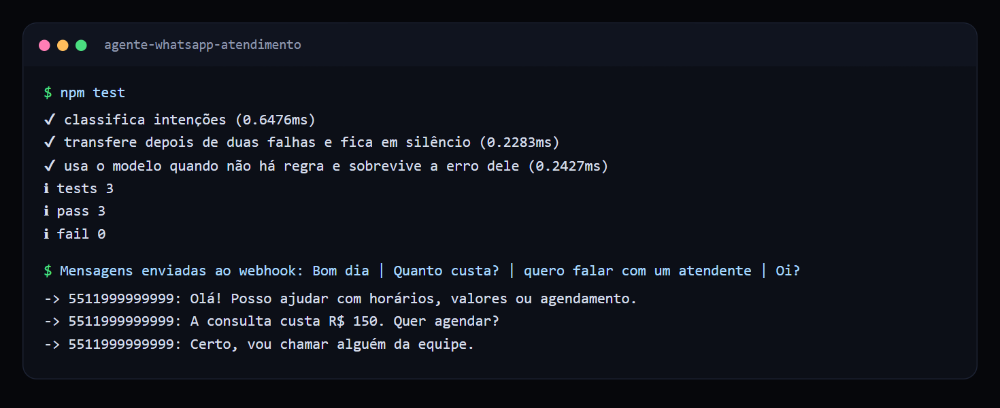
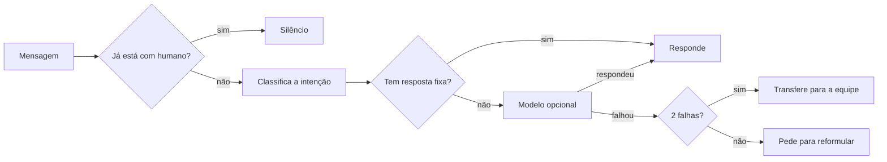

# Agente de atendimento para WhatsApp

Agente que responde clientes no WhatsApp, resolve as perguntas frequentes e passa a conversa para uma pessoa na hora certa.

  

## Veja funcionando



*Testes passando e uma conversa real pelo webhook: depois da transferência, o agente fica em silêncio.*

## O problema

Pequenas empresas recebem as mesmas perguntas o dia inteiro: horário, preço, como agendar. Um robô que só responde por menu irrita o cliente, e um robô que nunca desiste de responder é pior ainda. O atendimento precisa saber a hora de chamar um humano.

## O que ele faz

- Identifica a intenção da mensagem: saudação, horário, preço, agendamento ou pedido de atendente.
- Responde o que é conhecido com texto fixo, sem custo nem risco de resposta inventada.
- Aceita um modelo de linguagem opcional para as perguntas que as regras não cobrem.
- Transfere para a equipe quando o cliente pede ou depois de duas falhas seguidas.
- Fica em silêncio depois da transferência, para não atropelar a pessoa que assumiu.

## Como funciona



## Decisões técnicas

| Decisão | Motivo |
| --- | --- |
| Regras antes do modelo | Perguntas frequentes não precisam de IA: a resposta sai mais rápida, mais barata e previsível. |
| Modelo injetado como função | O núcleo não depende de fornecedor, e os testes rodam sem rede. |
| Erro do modelo vira falha comum | Se a API cair, o cliente recebe um pedido de reformulação, e não um silêncio. |
| Webhook responde 200 antes de processar | A Meta reenvia o evento quando a resposta demora. |

## Como rodar

Requer Node.js 24 ou superior. O projeto não tem dependências externas.

```bash
npm test
WHATSAPP_VERIFY_TOKEN=um-token npm start
```

```bash
curl -X POST localhost:3000/webhook -d '{"entry":[{"changes":[{"value":{"messages":[{"from":"5511999999999","type":"text","text":{"body":"Quanto custa?"}}]}}]}]}'
```

## Estrutura

```text
src/agente.ts     regras, transferência e fallback (sem dependência de canal)
src/servidor.ts   webhook no formato da WhatsApp Cloud API
test/             testes com o executor nativo do Node
```

## Próximos passos

- Enviar a resposta pela Graph API (hoje o envio é registrado no console).
- Validar a assinatura `X-Hub-Signature-256` do webhook.
- Guardar as conversas em banco de dados no lugar da memória.

## Sobre este projeto

Projeto de demonstração, com dados e empresas fictícios, criado para mostrar a abordagem técnica de forma simples.

## Autor

**Luiz Renato Carvalho**, Engenheiro de Software e IA · [luizrenato.dev](https://www.luizrenato.dev) · [LinkedIn](https://linkedin.com/in/luizrenatodc)
